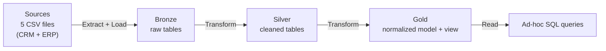
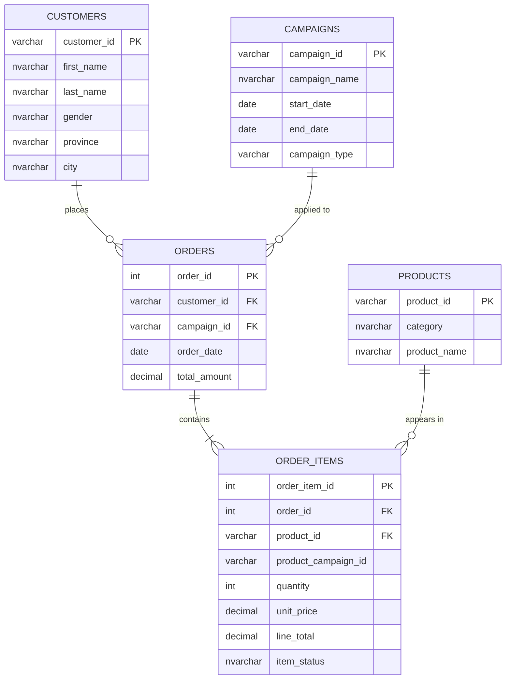

# Shopee Thailand Data Warehouse

An end-to-end **ELT pipeline** built in **SQL Server (T-SQL)** following the **Medallion architecture** (Bronze → Silver → Gold). Raw Shopee Thailand sales data (5 CSV files) is loaded, cleaned, standardized and modeled into a normalized relational (ER) model that is ready for analysis.

## Project Goals

- Build a repeatable ELT pipeline: raw CSV files → Bronze → Silver → Gold.
- Process, transform and clean raw data with T-SQL.
- Design a data model for the Gold layer.
- Validate data quality with automated SQL checks at every layer.

## Architecture
[DataWarehouse.png
](https://github.com/thanhtruc1920/Data-Warehouse-/blob/1564b42280dc042901ba9bcbeae8b4eb215ad0c6/DataWarehouse.png)


This is an **ELT** pattern: data is extracted from CSV files and loaded as-is into Bronze first, then transformed inside SQL Server.

| Layer | Purpose | Object type | Load | Transformations | Data model |
|---|---|---|---|---|---|
| **Bronze** | Raw copy of the source files | Tables | Full load: truncate + bulk insert | None | None (as-is) |
| **Silver** | Cleaned and standardized data | Tables | Full load, batch processing | Trimming, NULL handling, deduplication, value standardization, data quality checks | Source-aligned tables |
| **Gold** | Business-ready data | Tables | Full load: drop, create, insert | PK/FK constraints | Normalized (ER model) |

## Data Sources and Lineage

The CRM / ERP labels are a functional grouping of the files: customer and campaign data is treated as CRM, order and product data as ERP.

| Source file | System | Bronze | Silver | Gold |
|---|---|---|---|---|
| `shopee_customers_thailand.csv` | CRM | `bronze.crm_customer` | `silver.crm_customer` | `gold.customers` |
| `shopee_campaigns_thailand.csv` | CRM | `bronze.crm_campaign` | `silver.crm_campaign` | `gold.campaigns` |
| `shopee_orders_thailand.csv` | ERP | `bronze.erp_order` | `silver.erp_order` | `gold.orders` |
| `shopee_order_items_thailand.csv` | ERP | `bronze.erp_order_items` | `silver.erp_order_items` | `gold.order_items` |
| `shopee_products_thailand.csv` | ERP | `bronze.erp_product` | `silver.erp_product` | `gold.products` |

## Data Model (Gold Layer)
https://github.com/thanhtruc1920/Data-Warehouse-/blob/32cf7fc155519cbb4bc5b62530d3e629210957e0/ER_model.png



The diagram is simplified and does not show every column.

- One customer places many orders. One order contains one or more order items.
- One product appears in many order items.
- Orders without a campaign point to a placeholder row (`campaign_id = 'None'`) in `gold.campaigns`, so the foreign key always holds.

## Data Quality Checks

The Silver script reports problems instead of silently deleting data. Expected result for each rule check is `0`.

- Orphan keys: order → customer, order → campaign, order item → order, order item → product.
- `line_total` does not match `quantity × unit_price_after_discount`.
- NULL checks: count of NULL values in every column of each Silver table.
- Key checks: duplicate and missing key values in each table (`order_id`, `order_item_id`, `product_id`, `customer_id`, `campaign_id`).
- Row count reconciliation between Bronze and Silver (rows removed by deduplication).
- Negative amounts, quantities and prices.
- Delivery end date earlier than start date, registration date in the future, campaign end date earlier than start date.

The Gold script ends with row count and `SUM(line_total)` comparisons between Silver and Gold.

## Key Design Decisions

- **ELT with full load**: each script drops or truncates and reloads its tables, so it can be rerun safely from the start.
- **Bronze keeps data as-is**; all cleaning happens in Silver.
- **Suspicious rows are flagged, not deleted**, to avoid losing real revenue before the business rule is understood.
- **Explicit column lists** in every `INSERT INTO ... SELECT`, so column order changes cannot silently put values in the wrong column.
- **Parent tables load before child tables** in Gold, and tables are dropped in the opposite order, to respect foreign keys.

## Repository Structure

```
.
├── BRONZE.sql    # create database + schemas, create raw tables, bulk insert CSV files
├── SILVER.sql    # cleaning, standardization, data quality checks
├── GOLD.sql      # normalized model (PK/FK), flat view, post-load checks
└── README.md
```

## How to Run

**Requirements:** SQL Server 2017 or later (the scripts use `STRING_AGG` and `BULK INSERT ... FORMAT = 'CSV'`), SQL Server Management Studio, and the 5 CSV files.

1. Clone this repository.
2. Open `BRONZE.sql` and update each `BULK INSERT ... FROM '<path>'` to the location of your CSV files. The SQL Server service account must have read access to that folder.
3. Run `BRONZE.sql`, then `SILVER.sql`, then `GOLD.sql`, in that order.
4. After `SILVER.sql`, review the result sets: row count reconciliation, rule checks and NULL counts.
5. After `GOLD.sql`, confirm that row counts and `SUM(line_total)` match between Silver and Gold.

## Example Queries
Revenue by product category:

```sql
SELECT p.category,
       SUM(i.line_total) AS revenue,
       SUM(i.quantity)   AS units_sold
FROM gold.order_items AS i
JOIN gold.products AS p ON p.product_id = i.product_id
GROUP BY p.category
ORDER BY revenue DESC;
```

Revenue by province:

```sql
SELECT c.province,
       SUM(i.line_total) AS revenue
FROM gold.order_items AS i
JOIN gold.orders    AS o ON o.order_id    = i.order_id
JOIN gold.customers AS c ON c.customer_id = o.customer_id
GROUP BY c.province
ORDER BY revenue DESC;
```

## Tech Stack

SQL Server · T-SQL · SQL Server Management Studio · draw.io · Git / GitHub

## Possible Improvements

These are not implemented in this project:

- Incremental loading instead of full reload.
- Stored procedures with a logging table for run history.
- Orchestration of the three layers (for example with Airflow).
- A star schema layer on top of the normalized model.
- A BI dashboard on the Gold layer.

## Author

**[Your name]** · [LinkedIn](https://www.linkedin.com/in/your-profile) · [Email](mailto:your@email.com)
